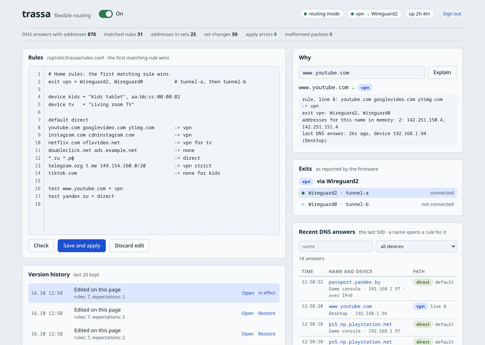
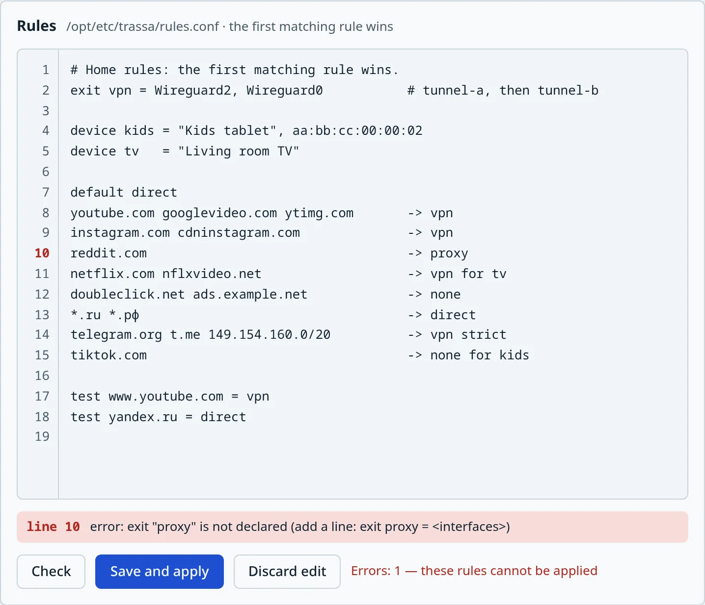
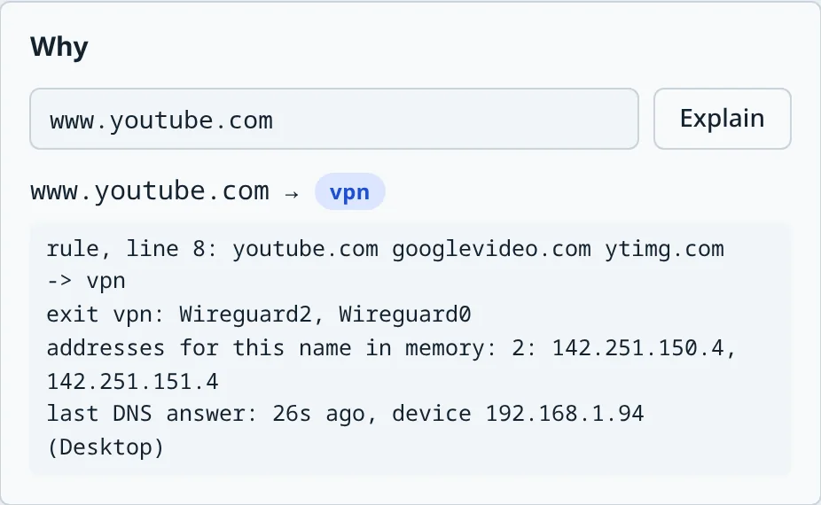
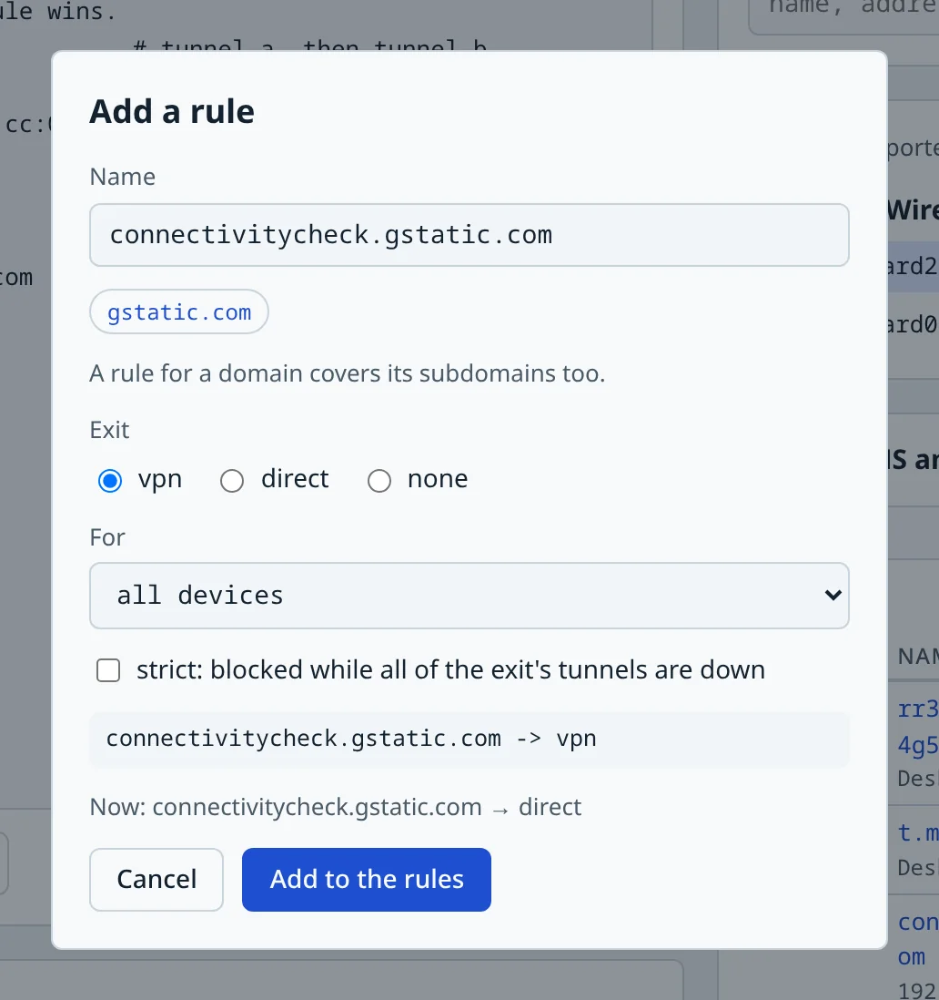

<h1 align="center">
   trassa
</h1>

<p align="center">
  <strong>Route by name, not by address.</strong><br />
  Split routing for Keenetic routers: the sites you choose go through a WireGuard tunnel,<br />
  everything else goes straight to your ISP, as it did before.
</p>

<p align="center">
  <a href="#install">Install</a> &nbsp; | &nbsp;
  <a href="#rules">Rules</a> &nbsp; | &nbsp;
  <a href="#web-page">Web page</a> &nbsp; | &nbsp;
  <a href="#commands">Commands</a><br />
  <sub>Keenetic and Netcraze &nbsp; | &nbsp; KeeneticOS 5 &nbsp; | &nbsp; ARM64 and MIPS &nbsp; | &nbsp; One static binary &nbsp; | &nbsp; MIT</sub>
</p>

<p align="center">
  <kbd> Keenetic</kbd> &nbsp;
  <kbd> Entware</kbd> &nbsp;
  <kbd> WireGuard</kbd>
</p>

trassa sends traffic to a VPN tunnel or straight to the ISP by domain name, mask, negation and
address. It reads the DNS answers your router already gives its clients, so a rule for
`youtube.com` follows YouTube wherever its addresses move. The rules are a short text file,
edited on a web page that the router serves itself.

```
youtube.com googlevideo.com -> vpn        # these domains and their subdomains through the tunnel
!*.ru -> vpn                              # everything except .ru
149.154.160.0/20 -> vpn strict            # never leaks: blocked while the tunnel is down
default direct                            # everything else as before
```

trassa is a single static Go binary (standard library only, no third-party code) that runs on
the router under Entware.

<p align="center">
  
</p>

## Features

<table>
  <tr>
    <td width="42%" valign="middle">
      <h3>Rules you can read</h3>
      <p>Domains with their subdomains, masks, regular expressions, subnets, lists in files. A rule can apply to some devices only, by their names in the router's device list. <b>none</b> blocks a site, <b>strict</b> blocks it while the tunnel is down instead of letting it leak.</p>
      <p>The page checks the rules before saving them, with errors and warnings by line; a file with errors is never applied. The last 20 versions are kept, and any of them is one click away.</p>
    </td>
    <td width="58%">
      <a href="docs/assets/readme/editor.webp"></a>
    </td>
  </tr>
  <tr>
    <td valign="middle">
      <h3>Ask why</h3>
      <p>Type a name, an address or a link: trassa answers which rule matched, which exit and tunnels the traffic takes, what each device list gets, and which addresses the DNS answers gave for it.</p>
    </td>
    <td>
      <a href="docs/assets/readme/why.webp"></a>
    </td>
  </tr>
  <tr>
    <td valign="middle">
      <h3>A rule from what your devices ask</h3>
      <p>The last 500 DNS answers of the home network, with the device that asked. Click a name to put together a rule for it or for one of its parent domains: the exit, all devices or only some, strict or not.</p>
    </td>
    <td>
      <a href="docs/assets/readme/add.webp"></a>
    </td>
  </tr>
</table>

It stays out of the way: traffic that matches no rule gets no mark at all, the switch in the
page's header turns trassa off, and if the daemon stops, the router routes as it did without it.

## How it works

```
DNS answer to a client ──► kernel queue ──► trassa: name → first matching rule → exit
                                              │
                                              ├─► address sets in the kernel (ipset)
                                              └─► the answer is released unchanged

packet from a client ──► mark by address set ──► routing table of the exit ──► tunnel or ISP
```

- trassa watches the DNS answers the router's DNS proxy sends to the home network. It never
  changes them and never asks DNS anything itself.
- When an answer matches a rule, its addresses go into the address set of the rule's exit.
  From then on the kernel routes new connections to those addresses without trassa.
- An exit is a list of WireGuard tunnels configured in the firmware; the first live one is
  used. When it goes down, the next one takes over.
- Traffic that matches no rule (with `default direct`) gets no mark at all: the router routes
  it exactly as without trassa.

## Routers

trassa has been tested on this router:

| | |
|---|---|
| Router | Netcraze Giga (NC-1012), hardware 1210C000, ARM64 (`aarch64`) |
| Firmware | KeeneticOS 5.2 Beta 0 (`5.02.B.0.0-0`), kernel 4.9-ndm-5 |
| Entware | `aarch64-3.10`: iptables 1.4.21, ipset 7.24, dropbear 2025.89 |

Netcraze is the Keenetic line under another brand: the same KeeneticOS, the same web and RCI
interfaces. trassa relies only on what the firmware has in common (RCI on `127.0.0.1:79`, the
Entware hooks in `/opt/etc/ndm/`, `WireguardN` interfaces, the `br0` home network), so a
Keenetic router with KeeneticOS 5.x should behave the same, but none has been tried. Older
firmware (4.x) has not been tried either.

Many Keenetic models run on MIPS (MediaTek MT7621, MT7628) rather than ARM64. trassa is built
for both: ARM64, and MIPS little- and big-endian. The MIPS builds have not run on a real router
yet. A MIPS router also has less memory and a slower processor than the tested one.

## Install

### What the router needs

- A Keenetic (or Netcraze) router with the firmware components **OPKG package manager**
  (`opkg`), **Netfilter kernel modules** (`opkg-kmod-netfilter`) and their **add-ons**
  (`opkg-kmod-netfilter-addons`). Installing components reboots the router.
- **Entware** installed on the router's internal storage or a USB drive, and SSH access as
  `root` (Entware's `dropbear`; key login recommended). With the firmware's own SSH server
  enabled, Entware's usually listens on port 222.
- At least one **WireGuard** connection set up in the firmware (only WireGuard interfaces can be
  exits).
- Clients use the router as their DNS server (the default). A device with its own encrypted DNS
  (DoH/DoT) is only covered by the address rules.

### From a release

On the router, as `root`:

```sh
opkg update && opkg install curl
curl -fsSL https://github.com/ufna/keenetic-trassa/releases/latest/download/install.sh | sh
```

The installer takes the package for the router's processor (ARM64, MIPS little- or big-endian)
from the [latest release](https://github.com/ufna/keenetic-trassa/releases/latest), checks its
checksum and installs it with `opkg`, together with `iptables` and `ipset`. trassa starts right
away in observe mode (below). The web page is at `http://192.168.1.1:8090`, or whatever the
router's address on the home network is: the installer prints it.

- **Upgrade:** run the `curl … | sh` line again. The rules, their history and the settings in
  `/opt/etc/trassa` stay as they are.
- **Remove:** `opkg remove trassa` stops trassa and removes everything it built in the kernel.
  The rules stay in `/opt/etc/trassa`; remove that folder too to forget them.
- The packages are also on the releases page, one per processor: `opkg install
  ./trassa_<version>_aarch64-3.10.ipk` installs a downloaded one.

On the first install trassa gets the default rules (`rules/rules.conf` in this repository); they
change nothing until you add rules. trassa starts at boot (Entware runs
`/opt/etc/init.d/S99trassa`). A supervisor restarts the daemon if it exits and a watchdog
restarts it if it stops answering.

### From source

You need **Go 1.22** or newer on your computer (`node` is optional: it runs the web page tests).

```sh
make test     # vet, tests, and builds for ARM64 and MIPS
make build    # build/trassa (this computer) and build/trassa-arm64
```

`tools/deploy.sh` builds trassa for the router's processor, chosen by Entware's architecture
(`opkg print-architecture`: `aarch64` → ARM64, `mipsel` → MIPS little-endian, `mips` → MIPS
big-endian, both with software floating point), checks that the build runs on the router, then
replaces the program and installs the init script and the firmware hooks. It needs `iptables`
and `ipset` on the router (`opkg install iptables ipset`):

```sh
TRASSA_ROUTER=192.168.1.1 TRASSA_SSH_KEY=~/.ssh/id_ed25519 tools/deploy.sh start
```

| Variable | Default | Meaning |
|---|---|---|
| `TRASSA_ROUTER` | `192.168.1.1` | the router's address on the home network |
| `TRASSA_SSH_KEY` | `backup/ssh/router_ed25519`, if present | private key for `root` on the router; otherwise ssh uses its defaults |
| `TRASSA_KNOWN_HOSTS` | `backup/ssh/known_hosts`, if present | known_hosts file for the router |
| `TRASSA_SSH_PORT` | `22` | port of Entware's SSH server; often `222` when the firmware's own SSH server is on |

The rules on the router are the master copy: `deploy.sh` never overwrites them and saves a copy
to `backup/rules/rules.conf` (not in git). A release package installs over a copy from
`deploy.sh`, and the other way round.

### Observe first, then route

Out of the box the daemon runs in **observe mode**: it reads DNS and writes what it would do
to the log, but changes no routes. Check that the decisions look right, then switch to
**routing mode**:

```sh
ssh root@192.168.1.1
trassa status                         # what trassa sees: DNS answers, rules, devices
trassa why www.youtube.com            # which rule matched and where the traffic goes
echo -route > /opt/etc/trassa/args    # routing mode for the whole home network
sh /opt/etc/init.d/S99trassa restart
```

`-route -source 192.168.1.50` routes only the traffic of one device, which is a good first step.

If the firmware's own domain routing is configured (DNS-based routes for a domain list), it
marks packets before trassa does and wins. Disable those routes in the firmware for trassa to
take over. The same goes for a device assigned to a firmware connection policy: its packets are
already marked, so trassa neither routes nor blocks them.

## Rules

The rules live in `/opt/etc/trassa/rules.conf` on the router. The first matching rule wins;
`#` starts a comment. `rules/rules.conf` in this repository is the commented default with
examples.

```
exit vpn = Wireguard0, Wireguard1     # an exit: tunnels in order of preference
exit work = office-tunnel             # a tunnel may be named by its description in the firmware

device tv     = "Living room TV"      # device lists for "for": a device is a name from the
device phones = "Pixel", aa:bb:cc:dd:ee:ff
device office = 192.168.1.50          # router's device list, a MAC or an IPv4 address

default direct                        # where everything that matches no rule goes

telegram.org t.me -> vpn              # a domain and all its subdomains
=example.com -> vpn                   # only this exact name
*.example.com -> vpn                  # only the subdomains
~^cdn[0-9]+\.example\.net$ -> vpn     # a regular expression (case-insensitive)
91.108.4.0/22 203.0.113.7 -> vpn      # subnets and addresses
example.org -> vpn strict             # strict: blocked while all tunnels of the exit are down
@lists/streaming.txt -> vpn           # conditions from a file in /opt/etc/trassa, one per line
twitch.tv -> vpn for tv, phones       # only for the devices of lists tv and phones
reddit.com -> vpn for !office         # for every device except those of list office
* -> vpn for tv                       # all the rest of the TV's traffic; the rules below skip it
ads.example.net -> none               # blocked: new connections are refused
!*.ru -> vpn                          # negation: everything except .ru (a broad rule: keep it last)

test t.me = vpn                       # expectations, checked every time the file is checked
test yandex.ru = direct
```

- `direct` is the ISP, i.e. the router's normal routing. It is always available.
- Without `strict`, traffic of a rule whose tunnels are all down goes direct.
- Internationalized names may be written as they are (`сайт.рф`); they are compared in punycode.
- A rule with `for` applies only to the devices of those lists, or with `!` to every device
  except them; other devices skip it. `default` and `test` are about devices in no list.
- trassa looks devices up in the router's device list every 30 seconds and follows their
  addresses; give listed devices a permanent address in the router's DHCP settings. A device's
  rules use every DNS answer on the network, not only the device's own.
- At most 16 device lists and 64 devices in all of them.
- `*` stands for all traffic: every name and every address. The rules above it still apply to
  the devices it is for; the rules below it do not, and the rest of their traffic goes to its
  exit, a default of their own at that place. `* -> direct for office` takes the office devices
  out of the VPN rules below it; `* -> vpn for tv` sends the whole TV through the tunnel; with the
  allowed sites above it, `* -> none for kids` blocks everything else. Without `for`, a `*` at the
  end is the same as `default`; anywhere else the rules below it apply to nobody. `*` stands alone
  in its rule and cannot be in a file of conditions.
- `none` blocks: new connections to the addresses of matching names and subnets are refused (the
  device gets an ICMP "prohibited": Linux and Android give up at once, Windows and Apple systems
  retry for a few seconds). Blocking works on addresses, as routing does: a site without a rule
  that shares an address with a blocked one (a CDN) is blocked too while that address is in
  memory, and a blocked site that shares an address with an earlier rule's site is not, so put
  `none` rules above the rules whose sites may share their addresses. A name never blocks a
  private address (the home network, a NAS, a network behind a tunnel); a subnet written in the
  rules does. DNS answers are not changed. `default none` blocks everything except the rules'
  sites and the home network.
- Blocking and routing work only while trassa routes: not in observe mode, not while it is turned
  off or restarting.
- A file with errors is never applied: the previous rules stay. Warnings (for example, a rule
  that can never match because an earlier one covers it) need an explicit confirmation.

Check a file on your computer with `build/trassa check rules.conf` and ask about a name with
`build/trassa why -f rules.conf www.youtube.com`.

## Web page

`http://<router>:8090` (the address is in `/opt/etc/trassa/web.args`). Sign in with the
router's administrator login and password: the page checks them with the firmware itself, and
the password never leaves the browser (only a response to a one-time challenge does).

On the page: the rules editor with errors and warnings by line, "why" for any name, address or
link, the state of the exits and tunnels, the version history with one-click restore (the last
20 versions are kept), and the last 500 DNS answers with the device's name from the router's
device list, refreshed every two seconds and filtered by name and by device. A name in the
answers opens a window that puts together a rule for it: the name or one of its parent domains,
the exit, all devices or only (or all but) a device list, strict; the rule goes to the end of the
editor and takes effect once saved. The page listens on the home network only.

The switch in the header turns trassa off and on. Off, the daemon stops and removes its routes,
and the router routes all traffic as without trassa; trassa stays off after a reboot until it is
switched on again. The page itself keeps working, and the rules can still be edited.

## Commands

```
trassa check <rules file>                     check a rules file
trassa why -f <rules file> <name or address>  decision by a rules file, without the daemon
trassa why <name, address or link>            decision and DNS details from the running daemon
trassa status                                 daemon state
trassa reload                                 reload the rules without stopping
trassa rollback [-y] [-dir directory]         undo the last rules change (run again to redo it)
trassa disable [-dir directory]               turn trassa off: stop the daemon, keep it off after a reboot
trassa enable [-dir directory]                turn trassa on again
trassa run [-rules file] [-only address]      run the daemon in observe mode
trassa run -route [-source address]           run the daemon in routing mode
trassa web [-listen address] [-dir directory] web page for editing the rules
trassa cleanup                                remove the DNS tap and routing rules
trassa version                                the version of this program
```

## Files on the router

| Path | What |
|---|---|
| `/opt/sbin/trassa` | the program |
| `/opt/etc/trassa/rules.conf` | the rules |
| `/opt/etc/trassa/history/` | the last 20 versions of the rules |
| `/opt/etc/trassa/args`, `web.args` | daemon and web page options |
| `/opt/etc/trassa/disabled` | present while trassa is turned off (the page's switch, `trassa disable`) |
| `/opt/var/lib/trassa/state` | addresses learnt from DNS, kept across restarts (written every 30 minutes and on stop) |
| `/opt/etc/init.d/S99trassa` | start at boot, supervision, stop |
| `/opt/share/trassa/rules.conf` | the default rules for a first install (from a release package) |
| `/opt/etc/ndm/netfilter.d/50-trassa.sh`, `/opt/etc/ndm/iflayerchanged.d/50-trassa.sh` | firmware hooks: rebuild after the firmware rewrites its tables, recheck tunnels when an interface changes |
| `/tmp/trassa.log` | the log, in RAM, trimmed above 1 MB |

In the kernel trassa uses the `mangle` chains `TRASSA`, `TRASSA_DNS` and `TRASSA_V<n>` (one per
combination of device lists in use), the queue 5353,
address sets `trassa_*`, marks `0x5452xxxx`, routing rules with priorities 199–299 and routing
tables 541–599. Nothing else in the firmware's tables is changed.

## If something goes wrong

- If the daemon stops or crashes, DNS keeps working (the kernel passes DNS answers by itself).
  The supervisor removes trassa's rules and restarts the daemon within seconds; until then
  traffic goes as without trassa, `strict` and `none` rules included.
- The quickest way back to the router's own routing is the switch on the page or
  `trassa disable` on the router: the daemon removes everything it built and stays off.
- `tools/router.sh trassa-off` stops trassa, disables the start at boot and removes everything
  it built, without relying on trassa itself. The same by hand on the router:

  ```sh
  sh /opt/etc/init.d/S99trassa stop
  chmod 644 /opt/etc/init.d/S99trassa
  for p in $(pidof trassa); do kill -9 $p; done
  for t in iptables ip6tables; do
    while $t -w -t mangle -D POSTROUTING -j TRASSA_DNS 2>/dev/null; do :; done
    $t -w -t mangle -F TRASSA_DNS; $t -w -t mangle -X TRASSA_DNS
  done
  iptables -w -t mangle -S PREROUTING | grep -- " -j TRASSA$" | sed "s/^-A/-D/" | while read -r r; do iptables -w -t mangle $r; done
  iptables -w -t mangle -F TRASSA
  for c in $(iptables-save -t mangle | sed -n "s/^:\(TRASSA_V[0-9]*\) .*/\1/p"); do
    iptables -w -t mangle -F $c; iptables -w -t mangle -X $c
  done
  iptables -w -t mangle -X TRASSA
  ip rule list | grep "fwmark 0x5452" | while read -r pref rest; do
    ip rule del pref "${pref%:}"
    t=${rest##*lookup }; t=${t%% *}
    case "$t" in 54[1-9] | 5[5-9][0-9]) ip route flush table "$t" ;; esac
  done
  for s in $(ipset list -n | grep "^trassa_"); do ipset destroy "$s"; done
  ```

  Never flush the table `main`: two of trassa's rules point to it.
- If you disabled the firmware's own domain routes for trassa, turn them back on.
- `tools/router.sh` also takes and compares backups of the router's firmware and settings and
  restores them (`backup`, `check`, `restore-config`, `restore-firmware`); run it without
  arguments for help. Backups go to `backup/`, which is not in git.

## Limitations

- IPv4 only: IPv6 traffic is not routed (DNS answers that arrive over IPv6 are still read), so a
  network with IPv6 internet access can reach blocked sites over IPv6.
- DNS over UDP through the router: DNS over TCP and encrypted DNS on the devices are not seen.
- Exits are WireGuard tunnels configured in the firmware; trassa does not bring tunnels up or
  down itself.
- Changing the list or the order of exits cuts tunnel connections in progress (the page asks
  for a confirmation); new connections follow the new rules at once.

## Development

```sh
make test
go run ./tools/webpreview         # the web page with sample data at http://127.0.0.1:8091/
make dist VERSION=0.1.0           # release files in dist/: the packages, install.sh, SHA256SUMS
```

The code and comments are in English; the Go standard library is the only dependency. A release
is the `v<version>` tag with the files from `make dist` attached; the packages are made by
`tools/package.sh` in the layout of OpenWrt's `ipkg-build`, and the same commit gives the same
files.

## License

[MIT](LICENSE)
